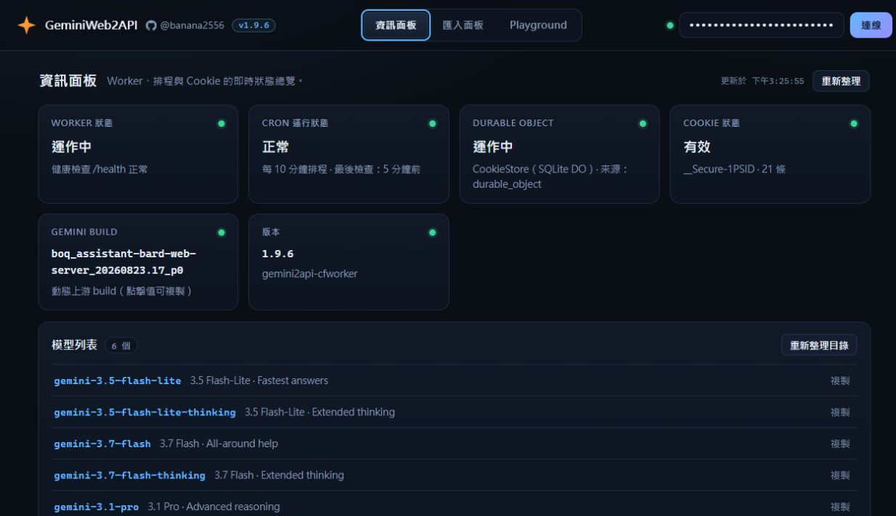
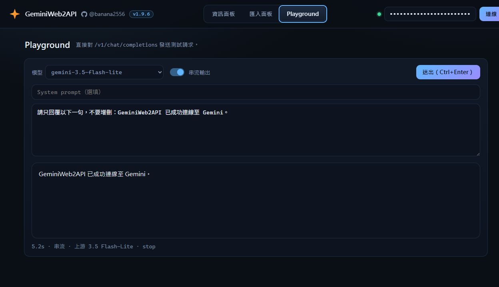
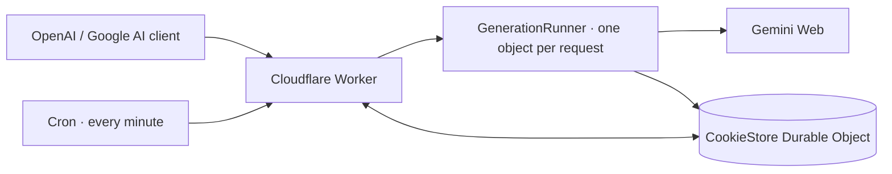

<p align="center">
  
</p>

<h1 align="center">GeminiWeb2API</h1>

<p align="center">
  <strong>Use Gemini Web through OpenAI- and Google AI-compatible APIs on Cloudflare Workers.</strong>
</p>

<p align="center">
  Single Worker file · zero runtime dependencies · streaming · tool calling · image input · web console
</p>

<p align="center">
  <a href="https://github.com/banana2556/gemini2api-cfworker"></a>
  <a href="https://workers.cloudflare.com/"></a>
  <a href="LICENSE"></a>
  <a href="https://github.com/banana2556"></a>
</p>

<p align="center">
  <a href="#quick-start">Quick start</a> ·
  <a href="#client-examples">Client examples</a> ·
  <a href="#configuration">Configuration</a> ·
  <a href="#api-reference">API reference</a> ·
  <a href="#troubleshooting">Troubleshooting</a>
</p>



<p align="center"><sub>Live deployment capture. The API key is masked and no Cookie value is displayed.</sub></p>

GeminiWeb2API translates Gemini Web's StreamGenerate protocol into familiar
OpenAI and Google AI request/response formats. It runs entirely on Cloudflare
Workers and includes a browser console for model discovery, Cookie management,
health checks, and live requests.

> [!IMPORTANT]
> This is an unofficial compatibility layer, not a Google or OpenAI service.
> Gemini Web protocol changes can break it without notice. Use only accounts
> and Cookies you control, and follow the applicable terms and usage limits.

## At a glance

| Interface | Endpoint | Highlights |
|---|---|---|
| OpenAI Chat Completions | `POST /v1/chat/completions` | Streaming, tool calls, image input and generated image output |
| OpenAI Images | `POST /v1/images/generations` | Dedicated image tool, image-only results, URL or Base64 output |
| OpenAI Responses | `POST /v1/responses` | Codex-compatible events and tool calls |
| Google AI | `POST /v1beta/models/{model}:generateContent` | Streaming and function calling |
| Browser console | `GET /` | Status, models, Cookie lifecycle, Playground |

Image input, generated images and signed-in model routes require a Gemini Cookie. Anonymous text
requests work without configuration through Gemini's guest auto-routing mode.

## Highlights

- **Drop-in client compatibility** for OpenAI-style and Google AI-style clients.
- **Dynamic model discovery** from the active Gemini account instead of a
  hard-coded model list.
- **Standard and Extended Thinking** aliases for Flash-Lite, Flash, and Pro.
- **Transparent routing metadata** through `upstream_model` / `upstreamModel`
  and `route_status` / `routeStatus`.
- **Persistent Cookie storage** in a SQLite Durable Object, with an automatic
  one-minute maintenance Cron Trigger with rotation at 95% of the known Cookie lifetime.
- **Cloudflare egress fallback** using raw TCP sockets when normal `fetch`
  traffic is rate-limited.
- **Single-file runtime** with no application dependencies.

## Quick start

### 1. Deploy

[](https://deploy.workers.cloudflare.com/?url=https://github.com/banana2556/gemini2api-cfworker)

Or deploy with Wrangler:

```bash
git clone https://github.com/banana2556/gemini2api-cfworker.git
cd gemini2api-cfworker
npx wrangler deploy
```

The checked-in `wrangler.toml` provisions the `COOKIE_STORE` and
`GENERATION_RUNNER` SQLite Durable Objects and the maintenance Cron Trigger.
The `v2` migration adds the generation runner and preserves existing Cookies.
Deploy the configuration as well as the script to enable the CPU-limit fix.
Pasting only `worker.js` into Cloudflare Quick Edit supports guest mode, but
does not provision the generation runner, persistent Cookie storage or
scheduled refresh; generation then remains subject to the ordinary Worker
CPU limit.

### 2. Choose an access mode

| Mode | Setup | Available routes |
|---|---|---|
| Guest | No variables or Cookie | `gemini-auto`, `gemini-auto-thinking`; text requests |
| Signed in | `API_KEYS` secret + imported Gemini Cookie | Account model catalog, image input, Pro/Flash routing |

For signed-in mode, protect the Worker before importing a Cookie:

```bash
npx wrangler secret put API_KEYS
```

`API_KEYS` accepts a comma-separated list or a JSON array. The same keys
protect API requests and unlock the browser console.

> [!CAUTION]
> An imported Cookie grants access to the connected Gemini session. Once a
> Cookie exists, the Worker deliberately refuses generation unless
> `API_KEYS` is configured.

### 3. Open the console

Visit the deployed Worker URL in a browser:

1. Enter one of the configured API keys.
2. In Firefox, sign in to `gemini.google.com`, then open **F12 → Storage →
   Cookies** and select the relevant Gemini or Google domain.
3. Open **Import / 匯入面板**. Copy the full **Value** of `__Secure-1PSID`
   into the first field and `__Secure-1PSIDTS` into the second field. The first
   field is required; leave the second empty if the account does not have it.
   Paste only the values, then click **Import and verify / 匯入並驗證**.
4. Confirm that the expected models appear in **Information / 資訊面板**.
5. Send a test request from **Playground**.

The console builds the Cookie from those two fields. You do not need to paste
Cookie names, a full Cookie header, JSON, or SAPISID. Copy complete values;
truncated values cannot verify a login. Import checks the structure and
refresh verifies the login with Gemini. Cookie values are stored only in the
Durable Object and are never returned by status endpoints. This follows
[Gemini-API's authentication approach](https://github.com/HanaokaYuzu/Gemini-API#authentication):
its optional `browser-cookie3` integration reads the local browser store,
including Firefox, and selects those two Cookies. A Cloudflare Worker cannot
read a local browser store, so copy or export the values into the console.
Firefox is recommended there because Chromium device-bound sessions can
prevent renewal; the recommendation is unrelated to SAPISID being absent.

When a mixed Cookie export returns a signed-out page or HTTP 401/403, manual
refresh retries with only `__Secure-1PSID` and `__Secure-1PSIDTS`, without a
`SAPISIDHASH` header. The reduced Cookie jar replaces the stored jar only after
Gemini's session RPC accepts it; failed verification retains the existing jar.

### 4. Verify the deployment

```bash
curl https://your-worker.workers.dev/health

curl https://your-worker.workers.dev/v1/models \
  -H "Authorization: Bearer your-api-key"
```

Omit the authorization header only when using guest mode with an empty
`API_KEYS` configuration.

## Client examples

Always fetch `/v1/models` first. Model versions are discovered from the
current account and can differ between rollout cohorts.

### OpenAI SDK

```python
from openai import OpenAI

client = OpenAI(
    base_url="https://your-worker.workers.dev/v1",
    api_key="your-api-key",  # Any non-empty placeholder works in open guest mode.
)

models = client.models.list()
model = models.data[0].id

response = client.chat.completions.create(
    model=model,
    messages=[{"role": "user", "content": "Hello!"}],
    stream=True,
)

for chunk in response:
    print(chunk.choices[0].delta.content or "", end="")
```

### Responses API

```bash
curl https://your-worker.workers.dev/v1/responses \
  -H "Authorization: Bearer your-api-key" \
  -H "Content-Type: application/json" \
  -d '{
    "model": "gemini-3.7-flash",
    "input": "Explain Cloudflare Workers in one sentence.",
    "stream": false
  }'
```

### Google AI format

```bash
curl https://your-worker.workers.dev/v1beta/models/gemini-3.7-flash:generateContent \
  -H "x-goog-api-key: your-api-key" \
  -H "Content-Type: application/json" \
  -d '{
    "contents": [
      {"parts": [{"text": "Hello!"}]}
    ]
  }'
```

The model IDs above are examples. Substitute an ID returned by your own
`GET /v1/models` or `GET /v1beta/models` request.

## Web console

The console is served by the Worker itself and does not require a separate
frontend deployment.

- **Information / 資訊面板** — Worker, Cron, Durable Object, Cookie, build, and model
  status.
- **Import / 匯入面板** — Cookie import, refresh, verification, and removal.
- **Playground** — model selection, optional system prompt, streaming, and
  route metadata.



<p align="center"><sub>Live streaming request through <code>/v1/chat/completions</code>; credentials remain masked.</sub></p>

## Models and routing

### Dedicated image API

Use `POST /v1/images/generations` with the adapter model `gemini-nano-banana-pro` to
request images directly. The prompt is a scene description; no chat messages
or "generate an image" instruction is required.

```json
{
  "model": "gemini-nano-banana-pro",
  "prompt": "An orange cat beside a sunny window, watercolor illustration",
  "n": 1,
  "response_format": "url"
}
```

The response has the OpenAI Images envelope: `created` and `data`, with
`data[].url` and `expires_at`. Use `response_format: "b64_json"` for
`data[].b64_json` and `mime_type` instead. It does not return completion text or
Markdown. `n` accepts 1–4; requests for multiple images can require multiple
upstream generations. URL downloads allow 20 MiB per image. Base64 output is
limited to 10 MiB per image and 20 MiB of image bytes across one response.
`size`, `quality`, `background` and `output_format` currently accept only `auto`;
the service determines actual dimensions, quality and encoding. Image requests
do not support streaming.

`gemini-nano-banana-pro` is a Worker adapter alias, advertised with
`supported_endpoints: ["/v1/images/generations"]`; it is not a separately
discovered Google model. The display name **Nano Banana Pro** follows
[Google's official name for Gemini 3 Pro Image](https://deepmind.google/models/gemini-image/pro/).
This alias names the Web Pro image-tool route; the Worker cannot independently
verify Google's underlying image-model version for every request.
It selects the current account's Pro route and adds
native image-tool routing flags (`inner[49] = 14`, `inner[17] = [[1]]`). These
flags were documented in the upstream project's
[unmerged ImageMode PR #209](https://github.com/HanaokaYuzu/Gemini-API/pull/209),
not the current library's `generate_content()` interface. The old fixed model
signature from that PR is not used; model IDs remain account-discovered.
Google may change this private protocol or restrict image access by account.
If the route fails or returns only text, the endpoint returns an error rather
than falling back to ordinary chat or guest generation. A login and an available
Pro route are required.

Select `gemini-nano-banana-pro` in Playground to test this endpoint; it switches the
request format and disables chat-only controls. Passing `gemini-nano-banana-pro` to Chat
Completions returns an endpoint guidance error.

### Generate images through Chat Completions

Use the same `POST /v1/chat/completions` endpoint and explicitly ask Gemini to
generate an image. Image generation must be enabled for the signed-in account;
the Worker does not grant permissions or force a text-only model to generate
images. The upstream [Gemini-API library](https://github.com/HanaokaYuzu/Gemini-API)
calls this `GeminiClient.generate_content()`; it is not itself an OpenAI HTTP
server.

```json
{
  "model": "your-model-id-from-v1-models",
  "messages": [{"role": "user", "content": "Generate an image of an orange cat sitting by a window."}],
  "stream": false
}
```

`choices[0].message.content` includes Markdown image links for chat clients.
The additional `choices[0].message.images` array provides structured
`{"type":"image_url","image_url":{"url":"https://your-worker/v1/images/…"},"alt":"…","expires_at":"…"}`
attachments. With `stream: true`, text remains incremental and a final image
chunk carries `delta.images` plus the Markdown links before `[DONE]`. Repeated
upstream image frames are deduplicated, and image-only turns are valid outputs.
Playground shows the images with download links in either mode.

Image URLs are encrypted capability links, valid for one hour, and can be opened
without adding an Authorization header. Anyone holding a link can download
that image until it expires. API keys and Google Cookies are not included in
the URL. Changing the configured keys or login session invalidates existing
links. Save the image while its link is valid; the Worker does not store image
files. Downloads attempt the upstream original-image RPC and fall back to the
preview when the original is unavailable. Only approved Google image hosts are
followed, and each download is streamed with a 20 MiB limit inside the generation
runner when available. Generated image output is exposed through Chat
Completions and the dedicated Images endpoint; the Responses and Google API
formats do not yet expose generated image attachments.

### Model discovery

With a configured Cookie, `GET /v1/models` exposes every model returned by
the account's current `GetUserStatus` response, with a standard and Extended
Thinking alias each. The catalog has no fixed model count or category allowlist;
new names such as Argon appear when Google includes them for that account.
The OpenAI model list also adds the `gemini-nano-banana-pro` adapter when the session has
a Pro route. Common chat aliases include:

| Family | Standard | Extended Thinking |
|---|---|---|
| Flash-Lite | `gemini-{version}-flash-lite` | `gemini-{version}-flash-lite-thinking` |
| Flash | `gemini-{version}-flash` | `gemini-{version}-flash-thinking` |
| Pro | `gemini-{version}-pro` | `gemini-{version}-pro-thinking` |

- Standard aliases use Gemini Web thinking level `1`.
- Extended Thinking aliases use level `2`.
- Level `3` is the separate Deep Think feature and is not exposed here.
- The signed-in catalog is cached for ten minutes and invalidated when the
  stored Cookie changes.
- `GET /v1/models?refresh=1` forces a fresh catalog lookup.
- Models are selected using the ID and protocol number returned by Google.
  Missing legacy `/app` route pairs do not hide a model; the model selection
  header is used in that case. Multiple versions in a category remain listed,
  while the newest Flash is preferred by default.

Without a Cookie, the Worker exposes only `gemini-auto` and
`gemini-auto-thinking`. Unknown client aliases remain usable in guest mode:
a `*-thinking` suffix keeps Extended Thinking, while other names map to
`gemini-auto`.

Responses preserve the requested alias and separately report the actual
upstream model and route status. This makes Pro fallback visible instead of
silently claiming the requested route succeeded.

<details>
<summary><strong>Paid account and Pro route details</strong></summary>

Paid Gemini / Google AI Pro accounts require Gemini Web's model-select header
(`x-goog-ext-525001261-jspb`). The Worker derives it from the current model ID
and account capacity returned by `GetUserStatus`. Use the console's Cookie
verification or `/debug` to distinguish:

- `pro_route_verified` — the request reached a Pro upstream model.
- `configured_but_pro_unavailable` — the request worked but fell back.
- `unverified` — Gemini returned no upstream model label.

</details>

## How it works



The ingress Worker checks API keys and forwards generation request and response
streams without parsing or buffering them. A per-request `GenerationRunner`
converts client messages and tools into Gemini Web payloads, streams
the upstream response back in the requested API format, and attaches truthful
routing metadata. Images are uploaded through Google's Scotty upload flow
before generation. The runner reads the existing Cookie store and validates
credentials before processing input. It writes no conversations to storage.

## Configuration

Edit `CONFIG` near the top of `worker.js`, or provide a Worker variable or
secret with the same name. Keep `API_KEYS` in Cloudflare Secrets.

| Variable | Required | Default | Purpose |
|---|---|---|---|
| `API_KEYS` | With a Cookie | `[]` | Comma-separated keys or JSON array for APIs and console access |
| `GEMINI_BL` | No | Auto-detected fallback | Gemini Web build used if automatic discovery fails |
| `GEMINI_ORIGIN` | No | `https://gemini.google.com` | Upstream origin or a clean-IP relay |
| `UPSTREAM_SOCKET` | No | `true` | Prefer raw TCP before falling back to `fetch` |
| `DEFAULT_MODEL` | No | `""` | Preferred alias; otherwise Flash Standard or guest auto |
| `RETRY_ATTEMPTS` | No | `3` | Maximum upstream attempts |
| `RETRY_DELAY_SEC` | No | `2` | Delay between retries |
| `REQUEST_TIMEOUT_SEC` | No | `180` | Timeout for each upstream request |
| `LOG_REQUESTS` | No | `true` | Request logging |
| `ENABLE_DEBUG` | No | `true` | Enable the live `/debug` probe |

Gemini login fields are intentionally not read from Worker variables or
secrets. Legacy `GEMINI_COOKIE`, `SAPISID`, `GEMINI_AUTH_USER`, and
`GEMINI_XSRF_TOKEN` values are ignored and can be removed.

For a public production deployment, consider setting `ENABLE_DEBUG=false`
after setup and troubleshooting are complete.

## API reference

| Method | Path | Description |
|---|---|---|
| `GET` | `/` | Browser console for HTML clients; health JSON otherwise |
| `GET` | `/health` | Public health, version, and current Gemini build |
| `GET` | `/v1/models` | OpenAI-style dynamic model catalog |
| `POST` | `/v1/chat/completions` | OpenAI Chat Completions |
| `POST` | `/v1/images/generations` | Image-only API using the dedicated `gemini-nano-banana-pro` model |
| `GET` / `HEAD` | `/v1/images/{token}` | Download a generated image using its one-hour encrypted link |
| `POST` | `/v1/responses` | OpenAI Responses-compatible endpoint |
| `GET` | `/v1beta/models` | Google-style dynamic model catalog |
| `POST` | `/v1beta/models/{model}:generateContent` | Google non-streaming generation |
| `POST` | `/v1beta/models/{model}:streamGenerateContent` | Google SSE generation |
| `GET` | `/admin/status` | Masked storage and Cookie status |
| `PUT` | `/admin/cookie` | Import a Cookie or Cookie Sync JSON |
| `POST` | `/admin/cookie/refresh` | Validate and persist approved Cookie rotations |
| `DELETE` | `/admin/cookie` | Remove the stored Cookie and return to guest mode |
| `GET` | `/debug` | Connectivity, masked Cookie status, and route probes |

### Authentication

Generation endpoints accept:

- `Authorization: Bearer <key>`
- `x-api-key: <key>`
- `x-goog-api-key: <key>`
- `api-key: <key>` or `apikey: <key>`
- `?key=<key>` for client compatibility

Prefer headers so keys do not appear in URLs or access logs. Cookie-management
endpoints use the same `API_KEYS` values but never accept query-string keys.

When `API_KEYS` is empty and no Cookie is stored, generation is public in
guest mode. When a Cookie exists, generation fails closed until a valid API
key is configured.

## Cookie lifecycle and security

- The console keeps the API key only in the current tab's `sessionStorage`.
- Raw Cookie values live only in `COOKIE_STORE` and are never included in
  status responses.
- Imports are normalized to approved authentication and anti-abuse fields;
  unrelated preference, search, and billing fields are discarded.
- Pasting a Cookie Sync JSON export preserves each Cookie's domain, path, and
  expiry. A raw `Cookie:` header contains only names and values, so its exact
  expiry cannot be recovered or displayed.
- Page-token caches are isolated by a cryptographic Cookie fingerprint, so
  switching accounts cannot reuse the previous account's XSRF token.
- Durable Object storage survives normal Worker deployments.

<details>
<summary><strong>Automatic refresh behavior</strong></summary>

The Cron Trigger wakes every minute but calls `RotateCookies` only when due.
For a known expiry, rotation is due at 95% of the period from Google's Cookie
issuance to its expiry. Imported exports without an issuance timestamp use the
import time as the start of the remaining known period. The earliest known
`__Secure-1PSIDTS`/`__Secure-3PSIDTS` expiry is used; if neither has expiry
metadata, the login session Cookie expiry is used. Legacy ten-minute due times
are recalculated automatically, without extending the deadline on each check.

Unknown expiry retains the ten-minute schedule with ±15-second jitter. Failed
rotations and overdue attempts that did not renew the Cookie retry in ten
minutes. Manual refresh can still run before the due time; a 60-second atomic
cooldown prevents overlapping calls. Approved `Set-Cookie` values are merged
into the persistent domain/path/expiry aware jar, and the lightweight activity
RPC continues on its own schedule. Failures retain the existing Cookie;
`reauth_required` is recorded only for explicit signed-out signals.

The displayed expiry is a browser storage deadline, not a guarantee that Google
will accept the session until that date. A two-year Cookie lifetime therefore
produces a rotation date nearly two years away under this policy; earlier
server-side invalidation still requires reauthentication.

Manual refresh returns `refreshed`, `no_rotation`, or
`reauth_required`. The Cookie details report `refresh_status: verified` when
Gemini accepts the login but Google does not
return a new `__Secure-1PSIDTS`. Rotation can extend a valid session but cannot recreate an
expired Google login. Re-import the Cookie when Google rejects the session,
the Cookie is manually removed, or Durable Object storage is deleted.

The ten-minute model catalog cache is separate from the session
refresh cadence.

Recent Chromium versions can issue device-bound Google sessions. Those
Cookies may remain valid for only a few hours and Google may refuse to renew
them outside the original browser, even when `RotateCookies` returns `200`.
For a service Cookie, the upstream reference project recommends exporting a
fresh Firefox session and closing that browser session after export.

</details>

## Troubleshooting

| Symptom | What to check |
|---|---|
| Production responses are empty or return `429` | Keep `UPSTREAM_SOCKET=true`, try a clean-IP `GEMINI_ORIGIN`, then inspect `/debug` |
| Responses suddenly become empty | Gemini build discovery is automatic; check `/health`, `/debug`, and upstream availability |
| `401 invalid api key` | Confirm the configured `API_KEYS` value and send it with a supported header |
| `503 api_keys_required_with_cookie` | Add `API_KEYS`; signed-in sessions are never exposed without protection |
| Pro requests fall back | Inspect `upstream_model` and `route_status`; verify that the account has Pro access |
| Cookie refresh reports `reauth_required` | Export a fresh Cookie from a signed-in Gemini browser session |

`GEMINI_BL` is discovered from Gemini's app page during upstream operations.
The page's `cfb2h` value is authoritative regardless of its server prefix,
including `boq_gemini-web-uiserver_`; legacy build strings elsewhere in the
page do not override it.
Its one-hour cache is scoped to the account session. Model catalog responses
include the build from the same lookup, its source (`upstream`, `cache`,
`stored`, or `configured`) and its check time. The console uses that account
result and labels fallback values explicitly. Refreshing the information or
model panel bypasses the ten-minute model cache and fetches the app build again.
`/health` remains a lightweight check: it reports only the configured fallback,
does not fetch Gemini, and does not verify upstream connectivity. A build date
is the label returned by Google, not the current date.

### Worker CPU or memory limit errors

Workers Free allows 10 ms of CPU per HTTP request. Network waiting does not
consume that budget, but HTTP framing, JSON parsing, image decoding and payload
encoding do. Each isolate has 128 MB of memory shared by its concurrent requests.
Increasing `REQUEST_TIMEOUT_SEC` does not raise either limit. See
[Cloudflare's resource limits](https://developers.cloudflare.com/workers/platform/limits/).

With the checked-in configuration, `/v1/chat/completions`, `/v1/responses` and
the Google generation endpoints run inside `GenerationRunner`. SQLite Durable
Objects are available on Workers Free and have a default **30-second CPU
budget per request**, separate from the ingress Worker's 10 ms budget. This
moves page discovery, JSON/payload conversion, image handling and upstream
stream parsing out of the ingress invocation. Each request receives a new
object ID; generation does not share the Cookie store's execution object.
The runner cannot be selected or bypassed with a client-supplied header.
See [Durable Object limits](https://developers.cloudflare.com/durable-objects/platform/limits/).

This consumes Durable Object requests and active duration, including time
waiting for Gemini while the object is active. Workers Free currently includes
100,000 Durable Object requests and 13,000 GB-s of duration per day, shared
with other objects such as `CookieStore`. Each active object is metered at
128 MB regardless of actual memory usage. Exceeding a daily allowance causes
failures until it resets; this is not unlimited free capacity. See
[Durable Object pricing](https://developers.cloudflare.com/durable-objects/platform/pricing/).
If the runner is bound but unavailable, ingress returns
`503 generation_runner_unavailable` without retrying generation locally.
An error after SSE headers were sent instead terminates the stream.

Deploy using `npx wrangler deploy`, confirm `GENERATION_RUNNER` is listed among
the bindings, and check `/health` for version `1.9.11` and
`generation_runtime: "durable_object"`. Replay the failing
conversation and inspect both Worker and Durable Object invocation logs.
Local tests do not enforce Cloudflare's deployed CPU limits. A logged
`cpuTimeMs: 20` with `exceededCpu` does not establish a 20 ms configured limit:
Cloudflare allows occasional overruns before terminating an invocation.
Increasing `limits.cpu_ms` on a Free ingress Worker does not raise its budget;
Workers Paid is another option if the application's traffic outgrows Free.

The Worker consumes generation responses incrementally, parses each frame once,
and applies backpressure to Socket and SSE streams. Non-streaming requests and
tool calls keep the final text instead of the complete upstream wire history.
Chat/Google requests with no tools (including an empty tools array) stream text
as it arrives. Tool-call and Responses API SSE events still wait for the final
result. Stream cancellation and incoming request abort signals cancel active
text-stream upstream reads, including page discovery. Wrangler enables incoming
request signal forwarding and the TransformStream backpressure fix explicitly
for the existing compatibility date. Immediate network-disconnect propagation
still needs deployed validation: local Wrangler/Miniflare tests did not observe
it within three seconds in either direct Worker or Durable Object mode, although
explicit cancellation and abort-signal unit tests pass.
Cookie activity maintenance runs through the configured
Cron Trigger rather than being attached to each chat request.

The following ceilings prevent unbounded buffering:

| Input | Ceiling |
|---|---|
| Generation API request body | 8 MiB, including JSON and Base64 images |
| One decoded image | 20 MiB; inline images also share the request-body ceiling |
| Buffered discovery / metadata response | 16 MiB |
| Total upstream generation data | 32 MiB |
| One upstream protocol line | 2,097,152 JavaScript string code units |

Oversized request bodies or images return `413`. Upstream resource ceilings stop
the request without retrying or switching to guest mode; non-streaming generation
returns `502`, while an already-open chat stream reports an upstream error.
These safeguards reduce resource use but do not guarantee arbitrary workloads
fit platform CPU, memory or daily usage limits. If the platform still terminates a request,
check its invocation outcome for `exceededCpu` or `exceededMemory` and compare
short text requests with the failing workload.

## Development

No install step is required for the Worker itself. Run the built-in Node test
suite with:

```bash
node --test
```

Then deploy with `npx wrangler deploy`.

## Limitations

- Gemini Web is an undocumented upstream protocol and may change.
- Guest mode usually routes to Flash-Lite and does not guarantee a requested
  Pro or Flash family.
- Image input requires a valid signed-in Cookie.
- Deep Think is not exposed as a model alias.
- Upstream account limits, regional availability, and service terms still
  apply.

## License

[MIT](LICENSE) © [banana2556](https://github.com/banana2556)
